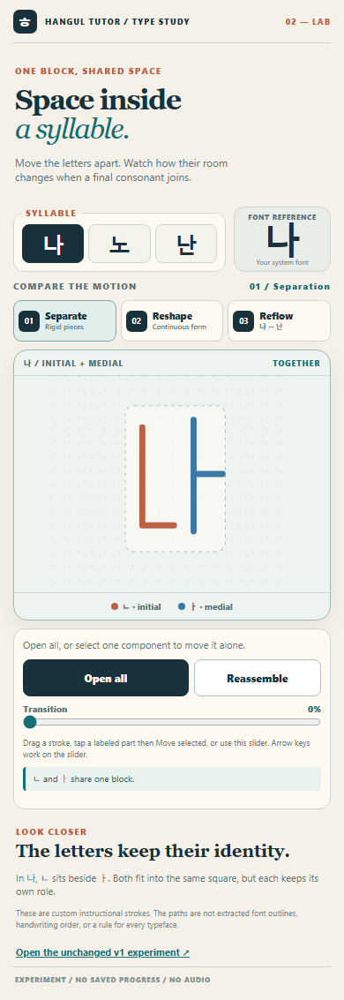
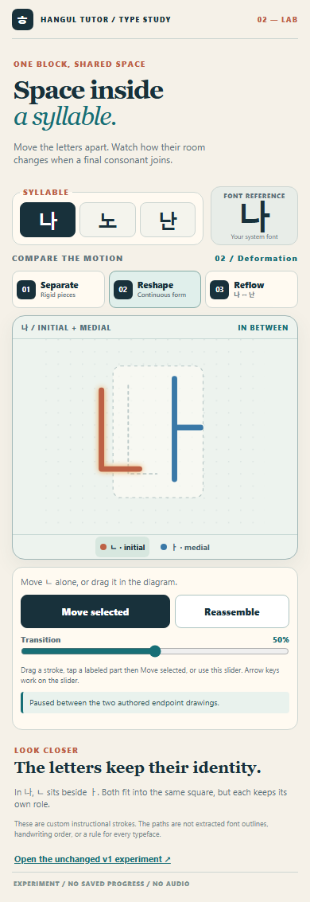
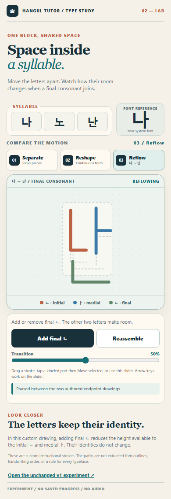
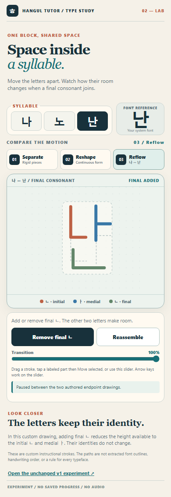

# Space inside a syllable — v2 type study

An isolated, unscored interaction study of how completed jamo share room inside 나, 노, and 난. It does not load the tutor curriculum, progress, audio, a backend, or a third-party font. The [v1 experiment](../exploding-syllable-lab/README.md) remains unchanged beside it.

## Open and compare

Open [index.html](index.html) directly in a modern browser, or serve this folder with any static HTTP server. Choose 나, 노, or 난, then choose one of four models:

1. **Separate:** move the packed parts apart as rigid drawings. This preserves the v1-style structural baseline.
2. **Reshape:** move each part while corresponding path points change continuously toward a larger standalone drawing.
3. **Reflow:** add or remove final ㄴ in 나 ↔ 난. The same upper SVG elements change their positions and proportions as a lower region becomes occupied or empty.
4. **Lift:** tap an individual jamo to lift it from a completed syllable and tap again to return it. Choose **A · Flat extraction** or **B · Shallow depth**. Both use the same path deformation, outward travel, timing, controls, and feedback; B adds only a forward CSS Z translation under perspective. Other components stay anchored. Optional dragging or the slider exposes intermediate positions.

Drag a visible stroke, choose a labeled component, use the action button, or use the progress slider. In Lift, a single tap on a stroke or its labeled part starts the lift; a second tap returns it. The slider supports arrow keys, and each component supports Enter or Space. Reassemble reverses the transition; reduced-motion preference makes button transitions immediate. A small system-font syllable is a visual reference, not a source of extracted outlines. The middle of a transition is a visualization, not a font glyph.

## Research and model

[Typography research](TYPOGRAPHY-RESEARCH.md) documents Unicode structure, contextual type design, font-specific choices, and the limits of precomposed glyphs. [Geometry specification](GEOMETRY.md) names each authored component and its interpolation. The paths are custom monoline SVG drawings. They are not handwriting strokes or a model for all Korean typefaces.

[Shallow-depth comparison](SHALLOW-DEPTH.md) describes the CSS perspective implementation, the A/B controls, uncontrolled differences, and a beginner evaluation plan. Depth here is a metaphor for inspecting a part. It is not a structural property of Hangul orthography.

## Review captures

The [captures](captures/) include rest, midpoint, expanded, reflow, reverse, and short-screen states. Selected frames:

Lift captures show both A and B at assembled, partial, lifted, and restored states: [flat assembled](captures/01-flat-assembled.png), [flat partial](captures/02-flat-partial.png), [flat lifted](captures/03-flat-lifted.png), [flat restored](captures/04-flat-restored.png), [depth assembled](captures/05-depth-assembled.png), [depth partial](captures/06-depth-partial.png), [depth lifted](captures/07-depth-lifted.png), and [depth restored](captures/08-depth-restored.png). [390×844](captures/09-depth-390x844.png) and [320×568](captures/09-depth-320x568.png) frames show the smaller layouts.

## Verification and decision boundary

Run `verify.py` and `verify_depth.py` with Python Playwright and Chromium. They generate review frames in the worktree's ignored `.verify_out/` directory; selected captures are copied into this folder for review. The [verification and evaluation report](VERIFICATION.md) records the exercised interactions, visual findings, and remaining limits. The responsive browser checks use simulated viewport and touch input, not a physical phone. Korean lettering review and beginner observation remain necessary before teaching claims or integration.
